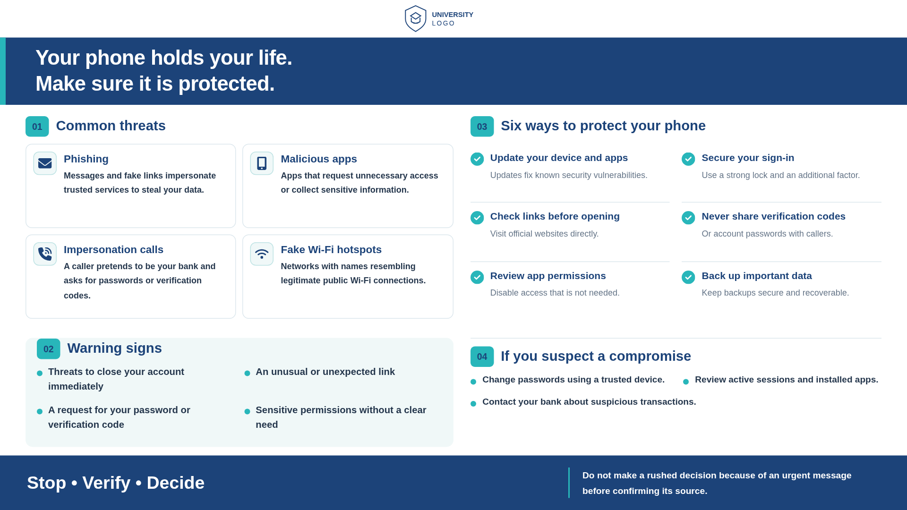
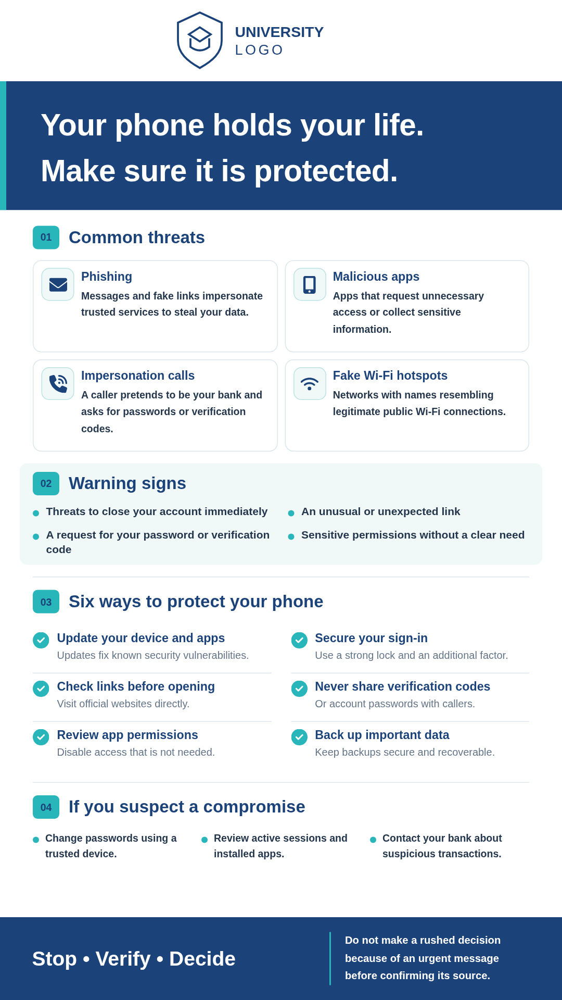
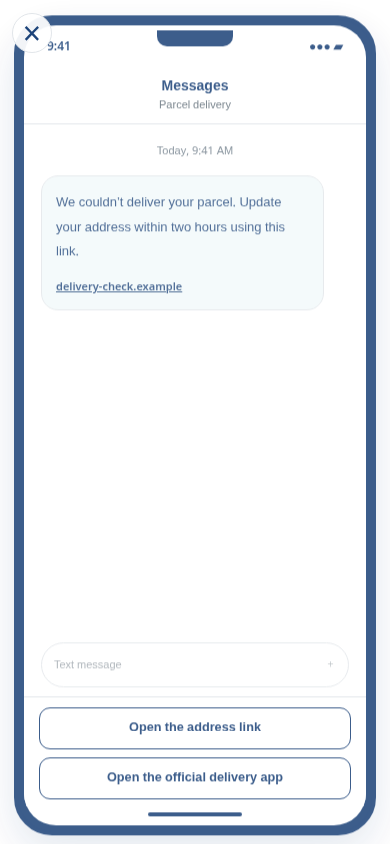
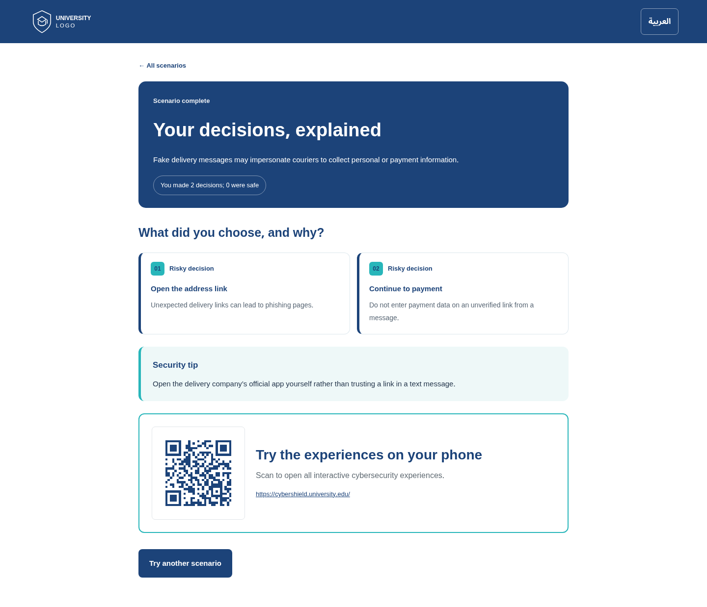

<div align="center">

# CyberShield

**Interactive cybersecurity awareness, built for real-world exhibition booths.**

A bilingual, open-source web app combining an approved digital-safety infographic, lifelike phone-based scenarios, and an unattended presentation mode.


</div>

CyberShield is the project name. For event signage, you can hide the on-screen name with `SHOW_BRAND_NAME=false` without changing the project identity.

## Preview



<table>
<tr>
<td width="50%"></td>
<td width="50%"></td>
</tr>
</table>



All documentation screenshots are captured with the interface in **English**. The live app also supports formal Arabic and right-to-left layout.

## Why CyberShield?

Security awareness works best when visitors make decisions for themselves. Rather than a slideshow full of questions, CyberShield presents normal-looking SMS messages, phone calls, browser pages, permission dialogs, and device settings. Visitors interact with a simulated phone; **no "correct/incorrect" message interrupts the scenario**. When a scenario ends, a clear review explains each decision, its risk, and one practical security tip.

The application does **not** perform actual attacks, collect credentials, send messages, request personal data, or contact live services.

## Features

| Feature                      | Details                                                                                                                                                                                                   |
| ---------------------------- | --------------------------------------------------------------------------------------------------------------------------------------------------------------------------------------------------------- |
| One approved infographic     | Faithful four-section Arabic source, professionally translated into English. Two fixed artboards (9:16 and 16:9), fitted to the live viewport from the first portrait frame without clipping or overflow. |
| 10 branching phone scenarios | Parcel scam, QR stickers, unnecessary app permissions, lookalike Wi-Fi, fraudulent bank call, fake update, suspicious alert, passkeys, fake technical support, and friend impersonation.                  |
| Realistic flow               | Immersive handset with in-app choices. Educational feedback is deferred until the final page.                                                                                                             |
| Clear completion review      | Every selected action is labeled a good or risky decision with a reason. Ends with a scenario-specific security tip.                                                                                      |
| QR handoff                   | During presenter mode, attendees can scan the QR from the experience selector **and the end-of-scenario review**. Generated locally; no third-party QR request.                                           |
| Digital signage              | Presenter starts `present`; first real mouse movement or touchscreen input opens scenarios. Returns to the infographic after configurable inactivity.                                                     |
| Languages                    | Arabic (`ar`, RTL) and English (`en`, LTR), with a documented extension pattern.                                                                                                                          |
| Brand control                | Primary `#1c4379`, secondary `#28b6ba`, Cairo typography, configurable PNG/SVG/WebP university logo, optional on-screen app name.                                                                         |
| Lightweight                  | Static HTML, CSS, and vanilla ES modules; no front-end framework or npm runtime packages.                                                                                                                 |

## Quick start

**Prerequisite:** Node.js **20 or newer**. No `npm install` is required.

```bash
cp .env.example .env
npm run dev
```

Open the URL printed in Terminal (usually **http://localhost:4173**), choose your language, and select a scenario. If port 4173 is occupied, the development server automatically tries 4174–4182 and prints the actual address.

```bash
npm test            # run automated checks
npm run build       # generate the static dist/ folder
npm run preview     # serve the generated dist/ locally
npm run check       # test and build together
```

### Local server ports

CyberShield uses port `4173` by default. If it is busy, the server automatically selects the next available port and prints the correct URL; the old process remains untouched. To choose a port explicitly:

```bash
PORT=4174 npm run dev             # macOS / Linux
npm run dev -- --port 4174        # any terminal with Node.js
```

You can also set `PORT=4174` in `.env`. If an explicitly selected nondefault port is already occupied, the server exits with a clear error instead of silently changing ports. To see which process owns a port on macOS:

```bash
lsof -nP -iTCP:4173 -sTCP:LISTEN
```

Use **Ctrl+C** in a terminal where the old server is running to stop it. Avoid killing an unidentified process.

> Do not open `index.html` directly with `file://`. The browser needs a local web server for ES modules and `config.json`.

### Display sizing

In presentation mode the poster stays within the **visible screen height**, even when the browser is opened directly in portrait orientation. The design re-fits automatically when you resize, rotate, enter fullscreen, or the mobile browser viewport changes. Landscape type and spacing use a separate 16:9 artboard to keep all four approved sections readable. The presentation page does not add a vertical scrollbar; the visitor selection and final review can scroll as normal.

## Operating a booth

Choose a language before entering presenter mode. On a Mac use **Option + K** to open the small command bar. Windows/Linux can use **Alt + K**; **F2** and **Ctrl + /** are fallbacks. If browser shortcuts conflict, append **`?controls=1`** to the URL and select your language.

| Command                           | Effect                                                                                         |
| --------------------------------- | ---------------------------------------------------------------------------------------------- |
| `present`                         | Show the approved infographic full screen in the app.                                          |
| `back`                            | From an active scenario/selector, return to the infographic. On the infographic, remain there. |
| `stop`                            | End presenter mode and return to normal visitor mode.                                          |
| `pause`, `resume`, `next`         | Compatibility commands. The approved infographic is the sole poster, so nothing rotates.       |
| `landscape`, `portrait`, `normal` | Override poster layout or use screen orientation.                                              |
| `flip`                            | Rotate the display 180° on physically inverted signage.                                        |
| `en`, `ar`                        | Switch language, including the infographic.                                                    |
| `fullscreen`                      | Request browser full screen when supported.                                                    |
| `home`, `help`                    | Navigate to home or list commands.                                                             |

The secret-looking shortcut is **not authentication**. For a public kiosk, consider keeping presenter deployment and visitor deployment on different origins or behind a private network if access restriction is important.

### Inactivity behavior

In presentation mode, any real mouse movement or touch opens the scenario selector. With no interaction for `EXPERIENCE_IDLE_SECONDS` (default: `60`), the kiosk returns to the infographic. **Visitor phones do not automatically time out.**

### QR codes: how they work

The QR is displayed after completing any story **only when presenter mode is active** (also visible on the presenter experience selector). Its destination is chosen in this order:

1. `PUBLIC_SITE_URL` if configured with a valid non-placeholder `http(s)` URL.
2. Otherwise, the current public **HTTPS page URL** (including the deployed subdirectory).

QR matrices are generated **inside the browser** via bundled open-source QR code logic; they work without a network request to a QR provider. If neither destination is possible, the completion page displays a **configuration explanation** instead of silently hiding the QR. For local presentations, set `PUBLIC_SITE_URL` to your **public visitor site**. `localhost` points to the visitor's own phone and will not work.

To test: open `present`, complete a story, confirm the QR and printed destination appear, then **scan it with a real phone** on cellular data. The phone must reach the visitor URL.

## Environment variables

Copy `.env.example` to `.env` for local development. On hosting platforms, set variables in the deployment dashboard or GitHub Actions repository **Variables**. All configuration is compiled into public `config.json`; never use environment variables here for secrets.

| Variable                   | Default                               | Purpose                                                                                 |
| -------------------------- | ------------------------------------- | --------------------------------------------------------------------------------------- |
| `PORT`                     | `4173`                                | Local dev/preview server port; when the default is busy, automatically tries 4174–4182. |
| `ENABLE_VISITOR_MODE`      | `true`                                | Allow public visitor experiences and QR destination.                                    |
| `ENABLE_PRESENTATION_MODE` | `true`                                | Allow the signage command bar and `present`.                                            |
| `PUBLIC_SITE_URL`          | placeholder                           | Optional public visitor URL; takes precedence over HTTPS origin fallback.               |
| `SHOW_QR_AFTER_EXPERIENCE` | `true`                                | Enable completion and presenter-selector QR.                                            |
| `SHOW_BRAND_NAME`          | `false`                               | Display/hide CyberShield name inside public UI.                                         |
| `SITE_NAME`                | `CyberShield`                         | On-screen brand label if enabled.                                                       |
| `SHOW_UNIVERSITY_LOGO`     | `true`                                | Show/hide institutional logo.                                                           |
| `UNIVERSITY_LOGO_PATH`     | `branding/university-logo.svg`        | Icon on navy headers (a white-rendered version works best).                             |
| `POSTER_LOGO_PATH`         | `branding/university-logo-poster.svg` | Logo in white space at top of infographic. PNG is supported.                            |
| `BRAND_PRIMARY`            | `#1c4379`                             | Main brand color.                                                                       |
| `BRAND_SECONDARY`          | `#28b6ba`                             | Accent color.                                                                           |
| `EXPERIENCE_IDLE_SECONDS`  | `60`                                  | Presenter kiosk inactivity reset.                                                       |
| `POSTER_DURATION_SECONDS`  | `180`                                 | Retained for compatibility; the single infographic does not rotate.                     |
| `DEFAULT_LANGUAGE`         | `ar`                                  | Locale fallback. Language picker still opens first.                                     |

### Brand customization

Replace the supplied **placeholder** university marks in `branding/` with your own authorized image files. For example:

```dotenv
SHOW_BRAND_NAME=false
SITE_NAME=CyberShield
SHOW_UNIVERSITY_LOGO=true
UNIVERSITY_LOGO_PATH=branding/university-logo.svg
POSTER_LOGO_PATH=branding/university-logo.png
BRAND_PRIMARY=#1c4379
BRAND_SECONDARY=#28b6ba
PUBLIC_SITE_URL=https://campus.example.edu/cybershield/
```

The infographic masthead is **white**, so use a dark or colored university logo there. Use a transparent PNG with sufficient resolution. All example URLs in the repository are placeholders: replace them with your actual deployed address. The only allowed brand highlights are primary and secondary; white and neutral backgrounds remain part of the layout.

## Deploy

### GitHub Pages

1. Create a GitHub repository for **CyberShield**, and push the source to `main`.
2. Go to **Settings → Pages → Build and deployment**, and select **GitHub Actions**.
3. Under **Settings → Secrets and variables → Actions → Variables**, set `PUBLIC_SITE_URL` to the actual Pages address if you want to override the automatically configured repository URL. Optionally set brand and feature flags.
4. The included [Pages workflow](.github/workflows/pages.yml) runs tests, builds, and publishes `dist/` on `main` changes.
5. Open the published URL on a phone and scan a kiosk-generated QR to confirm routing.

For a repository project page, the public URL generally includes a path: `https://OWNER.github.io/REPO/`.

### Cloudflare Pages, Netlify, Vercel or other static hosts

| Setting          | Value           |
| ---------------- | --------------- |
| Build command    | `npm run build` |
| Output directory | `dist`          |
| Node.js          | 20+             |
| Framework preset | None / static   |

Configure the public variables in the host dashboard, redeploy, and test on another device. No backend, database, or external QR API is required.

### Offline kiosk

Run `npm run dev` or `npm run preview` on the event laptop and use the browser's full-screen function. Local SVG assets and JS run offline. Cairo is loaded from Google Fonts when available; a system fallback is used offline. The QR handoff requires a separately reachable visitor site or appropriate LAN hosting.

## Project map

```text
CyberShield/
├── index.html                 Application entry point
├── styles.css                 Visitor UI and immersive handset
├── poster-sheet.css           Exact-size responsive infographic artboards
├── src/
│   ├── app.js                 State machine, command bar, presentation and reviews
│   ├── stories.js             Branching AR/EN stories with decision explanations
│   ├── single-infographic.js   Approved text (AR/EN)
│   ├── qr-generator.js        Offline in-browser QR SVG generator
│   ├── qr-runtime/            Bundled QR algorithm (attribution documented)
│   └── locales/               UI translations and locale registry
├── branding/                  Replaceable university logo
├── assets/icons/              Licensed Font Awesome SVGs
├── scripts/                   Static builder, dev server, configuration validation
├── tests/                     Node built-in test runner
├── docs/screenshots/          English interface screenshots
└── .github/workflows/         CI and GitHub Pages deployment
```

## Extending CyberShield

- **Add a scenario:** create a unique ID in `src/catalog.js`, define `scenes` in **both** `ar` and `en` in `src/stories.js`. Each scene has `kind`, `app`, `title`, `body`, and `actions`. Each action has `label`, `next`, `good`, and `reason`; `next:'end'` finishes the story. Only the review uses `reason`.
- **Add a language:** create `src/locales/<code>.js` matching the existing UI keys, register it in `src/locales/index.js`, and supply matching infographic and story translations. Ensure the language's direction is correct. Currently all ten stories are translated into both shipped languages.
- **Update the infographic:** edit `src/single-infographic.js`, preserving the same sections and content grouping; `poster-sheet.css` controls the exact 720×1280 and 1280×720 artboards. Keep paragraph copy concise enough for both orientations.
- **Adjust scenes and design:** `src/app.js` owns the renderer, and `styles.css` owns the phone and completion UI. Prefer realistic on-screen choices over a quiz or progress bar.

## Tests and quality checks

```bash
npm run check
```

Tests cover environment parsing, branding flags, locale/story parity, branching, retrospective analysis, single-infographic content, QR generation, and presenter handoff. Before a live exhibition, also manually verify the browser, physical screen orientation, touch behavior, the final QR on a second phone, network reliability, and font availability.

## Accessibility, security and privacy

- Keyboard-accessible buttons, visible focus states, readable labels, `lang`/`dir` switching, responsive phone screens, and reduced-motion support.
- Fictional `.example` links inside scenarios are **not navigable real phishing pages**. Never request actual credentials in a demo.
- No analytics, tracking service, account system, backend, microphone, camera, or real payments.
- `.env` and client JS are publicly inspectable; do not place secrets in them. Hiding the presenter command palette is not access control.
- Please report a potential security issue using [SECURITY.md](SECURITY.md). Review the [contribution guidelines](CONTRIBUTING.md) before a pull request.

## Contributing

Contributions to CyberShield are welcome, including improvements to scenarios, translations, accessibility, tests, and interface design. Please read [CONTRIBUTING.md](CONTRIBUTING.md) before submitting a pull request.

## License

CyberShield is open source under the [MIT License](LICENSE). See [THIRD_PARTY_NOTICES.md](THIRD_PARTY_NOTICES.md) for licenses and attribution for bundled dependencies and icons.
